<div align="center">

<picture>
  <source media="(prefers-color-scheme: dark)" srcset="assets/m-mark.svg">
  
</picture>

<h1>Hi there! </h1>

I'm Melvin. I run software projects and I test them, so when something breaks, I'd like to be the first to know.

<br>

<a href="https://www.linkedin.com/in/melvin-bulan-335987220/"></a>
<a href="https://github.com/melvinbulan17/dummio"></a>
<a href="https://ko-fi.com/mbulandev"></a>

<br>



<sub>Yes, there's a bug orbiting the moon. It's logged. Severity: low. Status: won't fix.</sub>

</div>

<br>

## 🌒 About me

I'm based in Cebu, Philippines. I started out testing software for Kyocera printers and worked my way up to test manager. Then I joined a Swiss startup, where I'm now the project manager on a public key infrastructure web app, the system behind digital certificates. I still test it, mostly by hand with some automation, and help with the code when I can.

I've loved web development since I was a kid, so I keep building things on the side. I like them clean and simple.

Bulan means moon, which is why my logo has a crescent tucked into the M.

```console
$ openssl verify -CAfile root.pem career.crt
chain: test-engineer → test-manager → project-manager
career.crt: OK
```

<br>

## 🌓 What I'm building

<a href="https://github.com/melvinbulan17/dummio"></a>

**[Dummio](https://github.com/melvinbulan17/dummio)** is a free Chrome and Firefox extension that fills web forms with realistic test data, Philippine and US, so nobody has to sign up as Juan Dela Cruz by hand again. It isn't in the stores yet, but you can [grab the preview build](https://github.com/melvinbulan17/dummio/releases/tag/preview).

<br clear="left">

I'm also working on **[my portfolio](https://github.com/melvinbulan17/my-portfolio)**, which still has lorem ipsum where the projects should go. I'll get there.

<br>

## 🌔 Tools

<p>
  
</p>

Also in the toolbox, minus a nice icon: Playwright, YouTrack, Jira, Confluence, Gitea and TeamCity.

<details>
<summary>And a few from my college days</summary>
<br>

</details>

<br>

## 🌕 Say hi

Testers, PMs and anyone stuck with a stubborn form can find me on [LinkedIn](https://www.linkedin.com/in/melvin-bulan-335987220/). If you find a bug in Dummio, please [open an issue](https://github.com/melvinbulan17/dummio/issues). I test software for a living, so I won't take it personally.

<br>

<div align="center">
  
</div>
